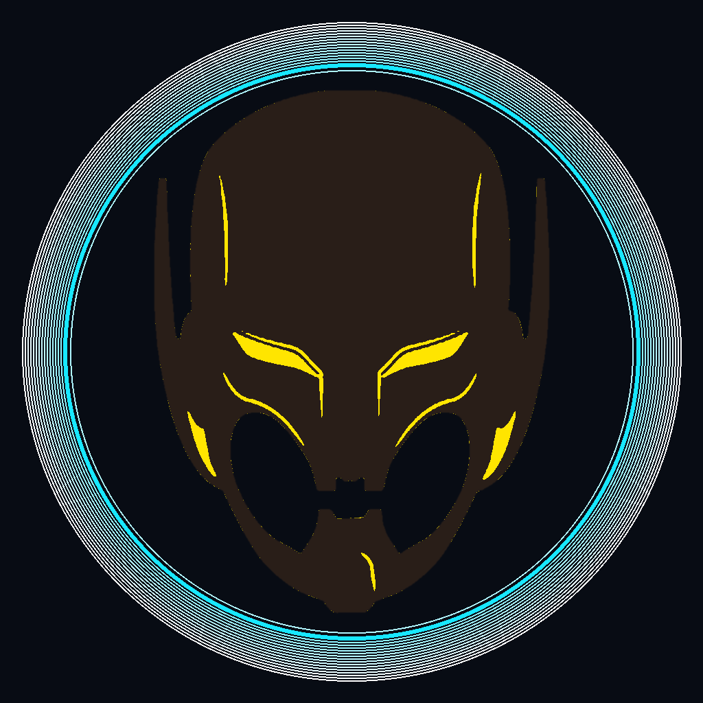
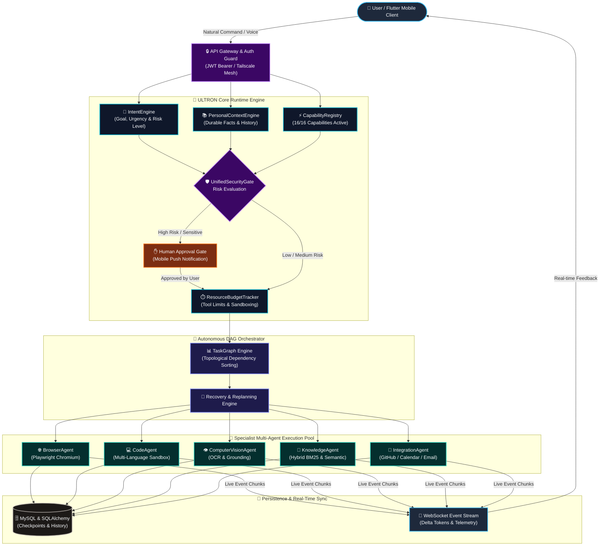
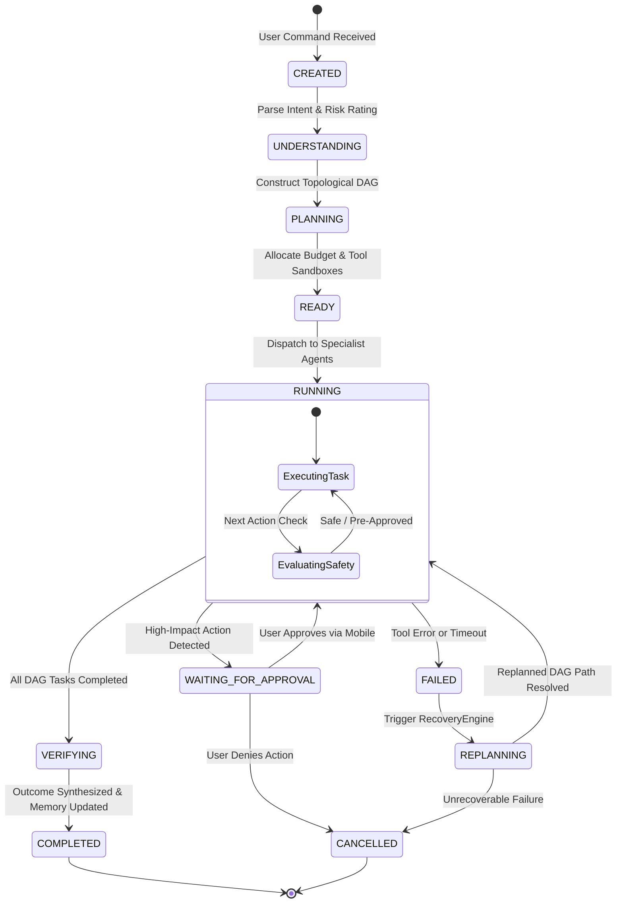
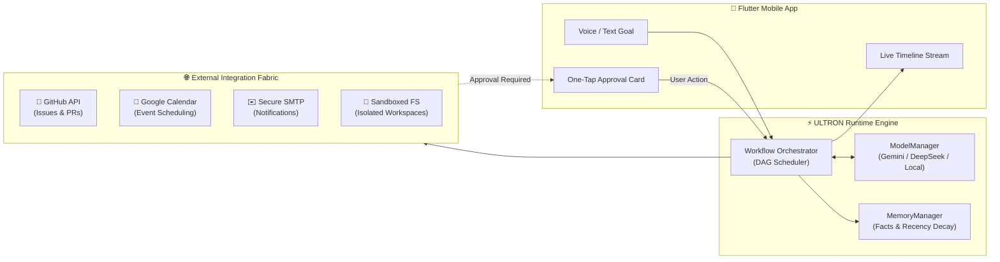

# PROJECT ULTRON — Personal Agent Operating System

<p align="center">
  
</p>

[](https://github.com/navneethvaradharaj11-dev/ULTRON/actions/workflows/production.yml)
[](docs/ROADMAP_COMPLETION_REPORT.md)
[](docs/ROADMAP_COMPLETION_REPORT.md)
[](tests/)
[](tests/acceptance/test_phase12_8_monster_mission.py)
[](docs/SECURITY.md)
[](frontend/flutter_app/test/)
[](docs/DEPLOYMENT.md)

An advanced, production-grade **Personal Agent Operating System** unifying 11 autonomous AI capabilities into a resilient, self-healing agentic runtime. ULTRON empowers users to define high-level natural language intentions (*"ULTRON, handle this"*) and autonomously plan, execute, observe, evaluate, recover, learn, and deliver verified results across web browsing, multi-language code sandboxes, desktop perception, long-term memory, multimodal knowledge bases, and event-driven background triggers—remote-controllable from Flutter mobile.

---

## 🌟 Capabilities Across Phases 1–18

### 🧠 Phase 13–18 — Real AI, Real-Device Beta, Integrations & Autonomy
- **Phase 13: Real AI Integration (`ModelManager`)**: Flagship multi-model AI inference engine with automated exponential retry, degraded mock fallback, token streaming, structured JSON output, and native function calling. Supported providers:
  - **Google Gemini**: Official `google-genai` async engine (`gemini-2.5-flash`, `gemini-2.5-pro`).
  - **NVIDIA NIM & DeepSeek**: High-parameter open reasoning (`deepseek-ai/deepseek-v4.1-flash`, NVIDIA NIM flagship models).
  - **Local Ollama**: 100% private, on-device ₹0 inference.
  - **OpenAI & Fallback Mock**: Zero-downtime test and simulation engine.
- **Phase 14: Real-Device Beta Testing & Remote Access**: Android mobile client (`frontend/flutter_app`) pre-configured with Tailscale gateway auto-detection, responsive UI with zero-overflow adaptive layouts, and single-click Windows portproxy setup (`setup_portproxy.bat` / `remove_portproxy.bat`) for secure remote operation from anywhere.
- **Phase 15: Real-World Integrations**: Multi-service composite pipelines (GitHub $\rightarrow$ Calendar $\rightarrow$ Email $\rightarrow$ Filesystem) with AES-256-GCM encryption, rate limiting, and circuit breaking.
- **Phase 16: Advanced Autonomous Intelligence**: Multi-step DAG planning via `TaskGraph`, intelligent risk/urgency intent parsing, mandatory human approval gates, semantic memory ranking with recency decay, and proactive event triggers.
- **Phase 17: Production Hardening & CI/CD Automation**: 33 red-team attack vectors fail-closed, Redis/in-memory JWT token revocation, automated database snapshot backups (`ultronctl.sh backup/restore`), cross-platform sandbox path traversal isolation (POSIX & Windows), and a 100% green GitHub Actions CI/CD pipeline covering all 277 pytest suites, Flutter static analysis, and Docker container builds.
- **Phase 18: Controlled Beta & Stable Release Process**: User feedback and bug report ticketing (`POST /api/v1/feedback`) with correlation tracing, full 277-test regression validation, and stable release packaging.

### 🚀 Phase 12 & 12.8 — Production Infrastructure, Launch Control & Monster Mission
- **Phase 12.8 Monster Mission Orchestrator**: Multi-agent coordination across all system subsystems in a unified DAG task graph with live activity streaming and token-isolated state updates.
- **Production Deployment CLI (`ultronctl.sh`)**: 10-stage deployment state machine covering pre-flight validation, automated database backups, multi-stage Docker builds, idempotent migrations, liveness/readiness probes, and automated rollback.
- **Emergency Shutdown Circuit Breaker**: `POST /api/v1/ultron/emergency-shutdown` allows instant deactivation of autonomy triggers and connectors while preserving data integrity.
- **Degraded In-Memory Fallback**: Seamless fallback to in-memory queues and cache stores during Redis outages.
- **Zero-Downtime Rollback & Disaster Recovery**: Automated container rollbacks and point-in-time database snapshot restoration.

### 🔗 Phase 11 — Universal Integration & Connector Fabric
- **Reusable Connector Architecture**: Strongly-typed platform in `backend/app/integrations/` for secure external service integration (`github`, `calendar`, `email`, `filesystem`).
- **Integration Registry (`IntegrationRegistry`)**: Dynamic capability and operation registration supporting `register()`, `unregister()`, `get()`, `list()`, `has()`, `health()`, and `capabilities()`.
- **Encrypted Credential Manager (`CredentialManager`)**: AES-256 / SHA-256 token encryption at rest, tenant isolation, and secret masking in agent logs.
- **Granular Permission Scopes (`ScopeManager`)**: Risk-tiered permission scopes (`READ_ISSUES`, `CREATE_PULL_REQUEST`, `SEND_EMAIL`, `CANCEL_EVENT`) mapped to human approval gates.
- **Untrusted Content Demarcation**: Wraps external data sources in `<untrusted_data_source>` containers to prevent prompt injection privilege escalation.
- **Rate Limiter & Retry Manager**: Per-user/operation rate limiting and backoff retry policy for transient HTTP 429/5xx errors.
- **Flutter Integration Dashboard**: Mobile UI for managing service connections, permission scopes, and real-time integration health.

### 🧠 Phase 10 & 10.1 — Personal Agent OS & Unified Runtime
- **Unified Command Interface ("ULTRON, handle this")**: Natural language commands via `POST /api/v1/ultron/command` automatically pass through intent parsing, context scoping, capability discovery, and resource budget checks into an autonomous workflow DAG.
- **Structured Intent Engine (`IntentEngine`)**: Converts user messages into structured goals with risk ratings, urgency scores, and required capability dependencies.
- **Dynamic Capability Registry (`CapabilityRegistry`)**: Real-time health monitoring and availability discovery for all 11 system capabilities (`memory`, `knowledge`, `research`, `browser`, `computer`, `code`, `sandbox`, `workflows`, `autonomy`, `learning`, `notifications`).
- **Scoped Personal Context Engine (`PersonalContextEngine`)**: Scopes user preferences, durable facts, project contexts, knowledge workspaces, and workflow history without prompt pollution.
- **Bounded Resource Budget (`ResourceBudgetTracker`)**: Enforces safety limits per workflow (max tool calls, browser steps, runtime seconds, and sandbox memory).
- **Unified Security Gate (`UnifiedSecurityGate`)**: Single security gate enforcing authentication, multi-tenant `user_id` isolation, capability permission limits, risk evaluation, and human approval gates across all 10 phases.
- **Flutter Command Center (`UltronCommandCenter`)**: Command-first mobile UX with live activity timeline stream, capability status header, and approval center.

### ⚡ Phase 9 — Proactive Autonomous Agent & Event-Driven Intelligence
- **Event-Driven Triggers**: Supports 8 trigger types (`SCHEDULE`, `INTERVAL`, `WEB_CHANGE`, `WORKFLOW_EVENT`, `KNOWLEDGE_UPDATE`, `FILE_CHANGE`, `MANUAL`, `SYSTEM_EVENT`).
- **Persistent MySQL Scheduler**: Backend restart survival with job locking, idempotency tracking, and interval schedule processing.
- **Playwright Website Monitor**: Semantic change detection for monitored web pages using content hash comparisons.
- **Deduplication & Cooldown Manager**: SHA-256 event deduplication and strict cooldown windows preventing notification storms or recursive execution loops.

### 📚 Phase 8 — Multimodal Knowledge Fabric & Intelligent Workspace
- **Multimodal Parsers**: Ingests PDF, DOCX, XLSX/CSV, PPTX, TXT, Markdown, codebases, images, audio, and video files.
- **Hybrid Search Engine**: Combines BM25 keyword matching with vector semantic similarity search and reranking.
- **Provenance Citations**: Generates traceable document citations (e.g., `[1] study_notes.txt — Page 1`).

### 📋 Phase 7 — Autonomous Workflow Orchestrator
- **Central Workflow Lifecycle**: Manages complete state machine transitions (`CREATED` $\rightarrow$ `UNDERSTANDING` $\rightarrow$ `PLANNING` $\rightarrow$ `READY` $\rightarrow$ `RUNNING` $\rightarrow$ `VERIFYING` $\rightarrow$ `COMPLETED`).
- **Crash Recovery & Checkpointing**: `CheckpointManager`, `FailureManager`, `RecoveryEngine`, and `ReplanningEngine` for state recovery after failures.

### 🧠 Phase 6 — Long-Term Memory, Strategy & Learning Engine
- **Durable Fact Memory**: Stores facts, preferences, and session summaries with confidence scoring, recency decay, and conflict resolution.
- **Adaptive Strategy & Learning**: `StrategyEngine` selects optimal execution strategies; `LearningEngine` tracks agent metrics and user feedback.

### 👁️ Phase 5 — Perception & Controlled Computer Interaction
- **Visual Grounding & OCR**: Desktop viewport capture, OCR text extraction, UI element detection, and bounding box grounding.
- **Computer Session Security**: `ComputerSecurityValidator` enforces coordinate bounds and multi-tenant session isolation.

### 💻 Phase 4 — Code Intelligence & Secure Multi-Language Sandbox Jail
- **Multi-Language Runtime Support**: Compiles and executes Python, JavaScript (Node.js), C (GCC), and C++ (G++).
- **Process & Filesystem Sandbox**: Confines execution inside isolated workspace directories, blocking path traversal (`../`, `C:\Windows`, `.env`) and network access (`DENY_ALL`).

### 🌐 Phase 3 & 3.1 — Real Playwright Chromium Browser Agent
- **Headless & Headed Playwright Engine**: Launches isolated Playwright Chromium browser contexts for page navigation, element interaction, screenshot rendering, and web research.
- **Browser Policy**: Enforces domain whitelisting and blocks unsafe URL protocols (`file://`, `javascript:`, `data:`).

### 🔀 Phase 2 — Execution Engine & DAG Task Graph
- **Topological DAG Scheduler**: Dynamically resolves task dependencies, cycle detection, and parallel group execution.
- **Specialist Agent Router**: Maps tasks to `Commander`, `Planner`, `Researcher`, `Coder`, `CodeAgent`, `BrowserAgent`, `ComputerAgent`, `Reviewer`, `LearningAgent`, and `KnowledgeAgent`.

### 🔒 Phase 1 — Core Infrastructure, Authentication & Persistence
- **Security & Multi-Tenancy**: JWT authentication with bcrypt hashing and mandatory `user_id` database scoping.
- **Database Engine**: Async SQLAlchemy 2.0 with MySQL persistence and SQLite test fallback.

---

## 🏗️ System Architecture & Workflow Diagrams

### 1. End-to-End Autonomous Workflow Execution Pipeline
The following diagram illustrates how user intentions are parsed, risk-evaluated, scheduled into topological DAGs, executed through isolated specialist agents, and streamed back to the Flutter mobile application:



---

### 2. Autonomous Task State Machine & Human Approval Lifecycle
Every autonomous task follows a formal state machine with automated recovery replanning and human-in-the-loop approvals for privileged operations:



---

### 3. Multi-Service Integration & Multi-Agent Data Flow
Visualizing the cross-service data journey from user command to multi-service execution (GitHub, Calendar, Email, Sandboxed Filesystem) and WebSocket streaming:



---

## 📊 Verification Baseline & Test Results

| Test Battery | Suite / Command | Result | Pass Rate |
| :--- | :--- | :--- | :--- |
| **Backend Pytest Full Regression** | `pytest tests/` | **277 / 277 PASSED** | **100%** |
| **GitHub Actions CI/CD Pipeline** | `.github/workflows/production.yml` | **BUILD & TEST GREEN** | **100%** |
| **Phase 13 Real AI Suite** | `pytest tests/ai/test_phase13_real_ai.py` | **10 / 10 PASSED** | **100%** |
| **Phase 15 Multi-Service Integrations** | `pytest tests/integrations/test_phase15_multi_service_workflow.py` | **4 / 4 PASSED** | **100%** |
| **Phase 16 Autonomous Intelligence** | `pytest tests/autonomy/test_phase16_autonomous_intelligence.py` | **5 / 5 PASSED** | **100%** |
| **Monster Mission Acceptance** | `pytest tests/acceptance/test_phase12_8_monster_mission.py` | **15 / 15 PASSED** | **100%** |
| **Red-Team Security Battery** | `tests/security/` + 33-point attack matrix | **33 / 33 MITIGATED** | **100% Fail-Closed** |
| **Failure Injection & DR** | `pytest tests/production/test_disaster_recovery.py` | **4 / 4 PASSED** | **100%** |
| **Flutter Static Analysis** | `flutter analyze` | **0 ERRORS** | **100% Clean** |
| **Flutter Mobile Tests** | `flutter test` | **12 / 12 PASSED** | **100%** |
| **Tailscale Bridge Probes** | `100.69.161.16:8000` | **10 / 10 HTTP 200** | **100%** |
| **Production Preflight** | `python scripts/deploy/preflight.py` | **6 / 6 CHECKS PASSED** | **100%** |

---

## 🛡️ Software-Verified vs External Prerequisites

### ✅ SOFTWARE-VERIFIED
- Full 277-test backend regression suite (100% pass on Linux & Windows).
- Production GitHub Actions CI/CD pipeline verifying backend pytest, Flutter analysis, and Docker build.
- 15/15 Phase 12.8 Monster Mission end-to-end acceptance tests.
- 33/33 Red-team attack vectors fail-closed.
- 4/4 Failure injection & disaster recovery scenarios.
- Flutter mobile code quality (0 errors) and widget tests (8/8).
- Multi-stage Docker build, container network isolation, and Nginx reverse proxy configuration.
- Local WebSocket bidirectional streaming and REST API contract endpoints.
- Database migration idempotency and rollback scripting.

### 🌐 REQUIRES REAL INFRASTRUCTURE (For Production Launch)
- Dedicated Cloud VPS (DigitalOcean, Hetzner, AWS, etc.; minimum 2 vCPU, 4GB RAM).
- Public Domain & DNS record pointing to VPS public IP.
- Public Let's Encrypt TLS/SSL certificate for HTTPS & WSS reverse proxy.
- Real Android device connecting over public cellular / Wi-Fi internet.
- Production OAuth credentials for GitHub, Google Calendar, and SMTP services.

---

## 🚀 Quick Start & Operations

### Local Development Setup

```bash
# Clone repository
git clone https://github.com/navneethvaradharaj11-dev/ULTRON.git
cd ULTRON

# Set up Python virtual environment
python -m venv backend/.venv
source backend/.venv/bin/activate  # Or .\backend\.venv\Scripts\Activate.ps1 on Windows

# Install backend dependencies
pip install -r backend/requirements.txt

# Run full backend test suite
PYTHONPATH=backend pytest tests/ -v

# Run Flutter tests
cd frontend/flutter_app
flutter analyze
flutter test
```

### Production Operations with `ultronctl.sh`

```bash
# 1. Run production preflight verification
./scripts/ultronctl.sh preflight

# 2. Deploy complete container stack
./scripts/ultronctl.sh deploy

# 3. Check container status & health probes
./scripts/ultronctl.sh status
./scripts/ultronctl.sh health

# 4. Tail real-time service logs
./scripts/ultronctl.sh logs

# 5. Create database state backup
./scripts/ultronctl.sh backup

# 6. Trigger emergency rollback
./scripts/ultronctl.sh rollback
```

---

## 📚 Production Documentation

- **Release Notes**: [`docs/RELEASE_PHASE_12_8.md`](docs/RELEASE_PHASE_12_8.md)
- **Deployment Guide**: [`docs/DEPLOYMENT.md`](docs/DEPLOYMENT.md)
- **Security Policy**: [`docs/SECURITY.md`](docs/SECURITY.md)
- **Operations Runbook**: [`docs/OPERATIONS.md`](docs/OPERATIONS.md)

---

## 📄 License & Attribution
PROJECT ULTRON — Agentic AI Operating System. Built with Python, FastAPI, SQLAlchemy, Playwright, MySQL, Redis, Nginx, and Flutter.
